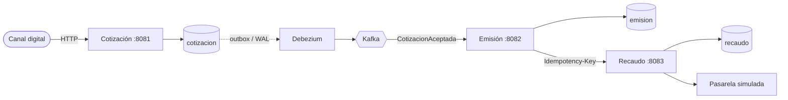

# Microservicios: Guía Táctica de Implementación · Código de referencia

[](https://github.com/modernsoftarch/microservices-tactical-guide/actions/workflows/ci.yml)

Este es el código completo del eBook **"Microservicios: Guía Táctica de
Implementación"** de [The Modern Software Architect](https://www.linkedin.com/in/3du4rd/).
El libro muestra fragmentos cortos que resaltan cada decisión. Aquí encuentras
el sistema completo: compila, tiene pruebas automáticas y lo puedes levantar en tu máquina.

El ejemplo es **Seguros Brújula**, una aseguradora ficticia con el problema de
cualquier aseguradora real: cotizar, cobrar y emitir pólizas sin cobrar dos
veces ni emitir pólizas sin pago, aunque la red falle, Kafka entregue mensajes
duplicados o un pod se reinicie a mitad del proceso.

## Qué vas a encontrar

| Patrón | Para qué sirve | Capítulo |
|---|---|---|
| Outbox + Debezium | Guardar un cambio y publicar su evento sin perder ninguno de los dos | 4 |
| Consumidor idempotente | Que un mensaje duplicado de Kafka no se procese dos veces | 4 |
| Saga orquestada con paso pivote | Coordinar cobro y emisión sin transacciones distribuidas | 4 |
| Idempotency-Key + `INSERT ... ON CONFLICT` | Reintentar un cobro sin cobrar doble | 3 |
| `@Retryable` y `@ConcurrencyLimit` de Spring 7 | Reintentos y bulkhead sin librerías extra | 3 |
| Capa anticorrupción | Aislar tu dominio de los códigos de la pasarela de pagos | 3 |
| ArchUnit | Que las reglas de arquitectura fallen el build, no la revisión de código | 7 |
| Testcontainers | Probar contra PostgreSQL y Kafka reales | 7 |
| Canary con Argo Rollouts | Desplegar con rollback automático por métricas | 6 |

El mapa completo capítulo → archivo está en [docs/mapa-del-libro.md](docs/mapa-del-libro.md).

## Arquitectura



1. **Cotización** calcula la prima. Cuando el cliente acepta, guarda el estado y
   el evento `CotizacionAceptada` en la misma transacción (outbox).
2. **Debezium** lee el outbox desde el WAL de PostgreSQL y lo publica en Kafka.
3. **Emisión** consume el evento, crea la saga y le pide a recaudo cobrar la prima.
4. **Recaudo** cobra una sola vez por Idempotency-Key, aunque le lleguen reintentos.
5. Con el cobro aprobado, emisión crea la póliza y publica `PolizaEmitida`.

Detalle, diagrama de secuencia y tabla de fallas: [docs/arquitectura.md](docs/arquitectura.md).

## Requisitos

- Java 21 o superior
- Maven 3.9 o superior
- Docker (Docker Desktop, Rancher Desktop, Colima o Podman con socket compatible)
- `curl` y `jq` para el script de demostración

## Cómo verificar que el código funciona

```bash
mvn verify
```

Esto ejecuta, en cada servicio:

- **Pruebas unitarias** (`*Test`): reglas de dominio sin Spring, en milisegundos.
- **Reglas de arquitectura** (`ReglasDeArquitecturaTest`): el dominio no depende
  de Spring ni de la infraestructura.
- **Pruebas de integración** (`*IT`): levantan PostgreSQL y Kafka reales con
  Testcontainers. La primera vez descargan las imágenes y tardan un poco más.

Las pruebas que vale la pena leer primero:

| Prueba | Qué demuestra |
|---|---|
| `AceptacionConOutboxIT` | El evento y el cambio de estado se guardan juntos, y el outbox exige transacción |
| `CobroIdempotenteIT` | 10 peticiones concurrentes con la misma clave producen un solo cobro |
| `SagaEmisionIT` | Duplicados, rechazos, caída de recaudo y reintentos agotados |
| `FlujoKafkaIT` | Un evento con el formato de Debezium, entregado dos veces, produce una sola póliza |

En GitHub Actions, cada cambio ejecuta `mvn verify`, construye las tres imágenes
y además levanta el entorno completo con `docker compose` (incluido Debezium)
para recorrer el flujo real: una póliza emitida y una emisión rechazada. El
badge de arriba muestra el resultado.

## Cómo ejecutarlo en tu máquina

```bash
docker compose up --build -d     # PostgreSQL, Kafka, Debezium y los tres servicios
./scripts/demo.sh                # cotiza, acepta y espera la póliza
```

Salida esperada del demo:

```json
{
  "cotizacionId": "…",
  "estado": "EMITIDA",
  "numeroPoliza": "POL-1A2B3C4D",
  "motivo": null,
  "intentos": 0
}
```

Prueba también los caminos que no son felices:

```bash
# La pasarela rechaza el pago → estado RECHAZADA
./scripts/demo.sh tok_fondos_insuficientes

# Recaudo caído: la saga queda COBRO_PENDIENTE y se retoma sola cuando vuelve
docker compose stop recaudo
./scripts/demo.sh            # en otra terminal, a los pocos segundos: docker compose start recaudo
```

Para ver los eventos que publica Debezium:

```bash
docker compose exec kafka /opt/kafka/bin/kafka-console-consumer.sh \
  --bootstrap-server localhost:9092 --topic brujula.poliza --from-beginning \
  --property print.headers=true
```

Para apagar y borrar los datos: `docker compose down -v`.

### API

| Método | Ruta | Servicio |
|---|---|---|
| `POST` | `/api/v1/cotizaciones` | cotización · `{"clienteId","producto":"AUTO\|HOGAR\|VIDA","valorAsegurado"}` |
| `GET` | `/api/v1/cotizaciones/{id}` | cotización |
| `POST` | `/api/v1/cotizaciones/{id}/aceptacion` | cotización · `{"medioDePago":"tok_visa"}` |
| `GET` | `/api/v1/emisiones/{cotizacionId}` | emisión |
| `POST` | `/api/v1/cobros` | recaudo · header `Idempotency-Key` obligatorio |

Cada servicio expone `/actuator/health` y `/actuator/prometheus`.

## Estructura

```
.
├── servicios/
│   ├── cotizacion/      # dominio · aplicacion · infraestructura (web, persistencia)
│   ├── emision/         # + mensajeria (Kafka) y recaudo (cliente HTTP)
│   └── recaudo/         # + pasarela (capa anticorrupción)
├── infra/
│   ├── debezium/        # conectores del Outbox Event Router
│   ├── k8s/             # Deployment, Rollout canary, ExternalSecret
│   ├── observabilidad/  # alertas de Prometheus y OpenTelemetry Collector
│   └── postgres/        # una base de datos por servicio
├── docs/
│   ├── arquitectura.md
│   ├── mapa-del-libro.md
│   └── decisiones/      # ADRs
├── scripts/demo.sh
├── docker-compose.yml
├── Dockerfile           # una imagen por servicio: --build-arg SERVICIO=...
└── AGENTS.md            # contexto para agentes de código (capítulo 8)
```

Cada servicio sigue la misma organización:

- `dominio`: reglas del negocio en Java puro. Sin Spring.
- `aplicacion`: casos de uso y límites de transacción.
- `infraestructura`: adaptadores HTTP, JDBC, Kafka y clientes externos.

Usamos `JdbcClient` en lugar de JPA para que el SQL de cada patrón quede a la
vista, igual que en el libro.

## Decisiones de arquitectura

- [ADR-001: Publicar eventos con Outbox y Debezium](docs/decisiones/ADR-001-outbox-con-debezium.md)
- [ADR-002: Saga orquestada con el cobro como paso pivote](docs/decisiones/ADR-002-saga-orquestada-con-cobro-pivote.md)
- [ADR-003: Idempotencia del cobro](docs/decisiones/ADR-003-idempotencia-en-recaudo.md)

## Versiones

| Componente | Versión |
|---|---|
| Java | 21 (LTS) |
| Spring Boot | 4.1 (Spring Framework 7) |
| PostgreSQL | 17 |
| Apache Kafka | 4.2 (KRaft, sin ZooKeeper) |
| Debezium | 3.7 |
| Testcontainers | 2.x (versión gestionada por Spring Boot) |

Dependabot mantiene las dependencias al día.

## Esto es código didáctico

Está pensado para leerse y para que lo adaptes, no para copiarlo tal cual a
producción. Lo que falta a propósito (autenticación, pruebas de contrato,
circuit breaker) y por qué está en [docs/mapa-del-libro.md](docs/mapa-del-libro.md#lo-que-el-repositorio-no-incluye-a-propósito).

¿Encontraste un error o tienes una pregunta? Abre un issue.

---

**The Modern Software Architect** · Arquitectura de software del mundo real,
explicada por alguien que la ha vivido en banca y seguros.
