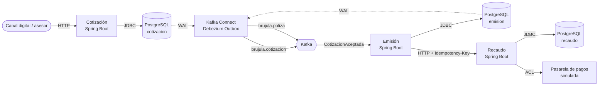
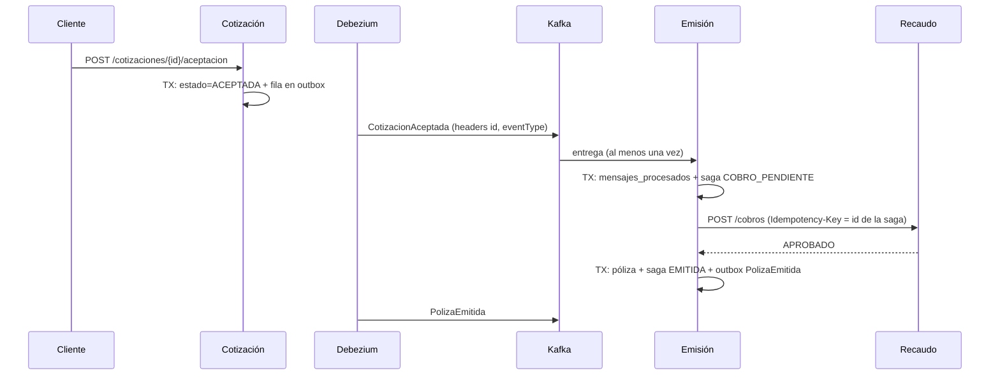

# Arquitectura de Seguros Brújula (código de referencia)

Seguros Brújula es la aseguradora ficticia que acompaña el libro. Este
repositorio implementa el flujo **cotizar → aceptar → cobrar → emitir póliza**
con tres servicios.

## Vista de contenedores (C4 nivel 2)

## Secuencia del camino feliz

## Qué pasa cuando algo falla

| Falla | Qué hace el sistema | Dónde está el código |
|---|---|---|
| Kafka entrega el evento dos veces | `mensajes_procesados` lo descarta | `SagasJdbc.registrarMensaje` |
| Recaudo no responde | `@Retryable` reintenta 3 veces; si no, la saga queda pendiente | `RecaudoHttp` |
| Emisión se reinicia a mitad del cobro | el reintentador retoma la saga con la misma clave | `ReintentadorDeSagas` |
| Dos réplicas avanzan la misma saga | solo una gana el `UPDATE ... WHERE estado = ...` | `SagasJdbc.transicionar` |
| Reintentos agotados | saga `REQUIERE_REVISION` + alerta | `OrquestadorEmision`, `prometheus-reglas.yaml` |
| La pasarela rechaza el pago | saga `RECHAZADA` + evento `EmisionRechazada` | `OrquestadorEmision.rechazar` |
| Mensaje que no se puede procesar | 3 reintentos y luego al tópico `-dlt` | `ConfiguracionEmision` |
